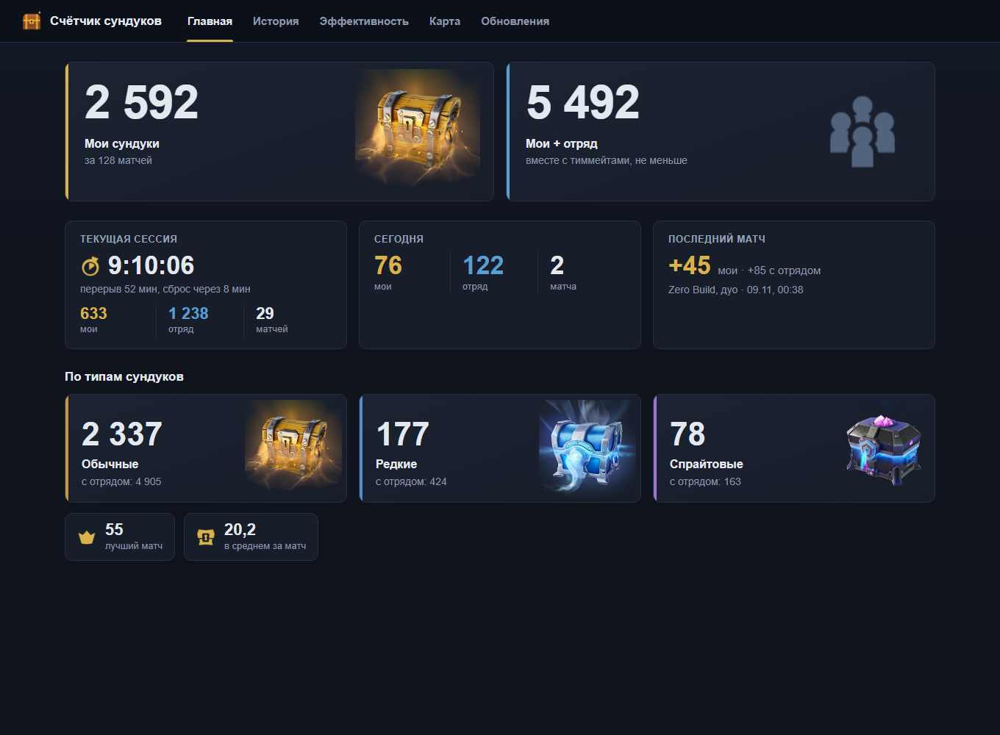
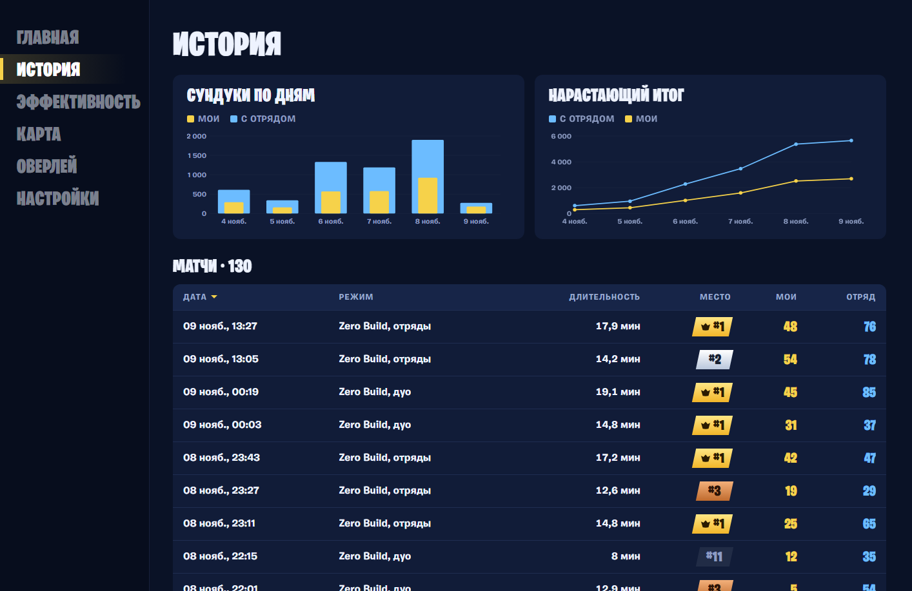
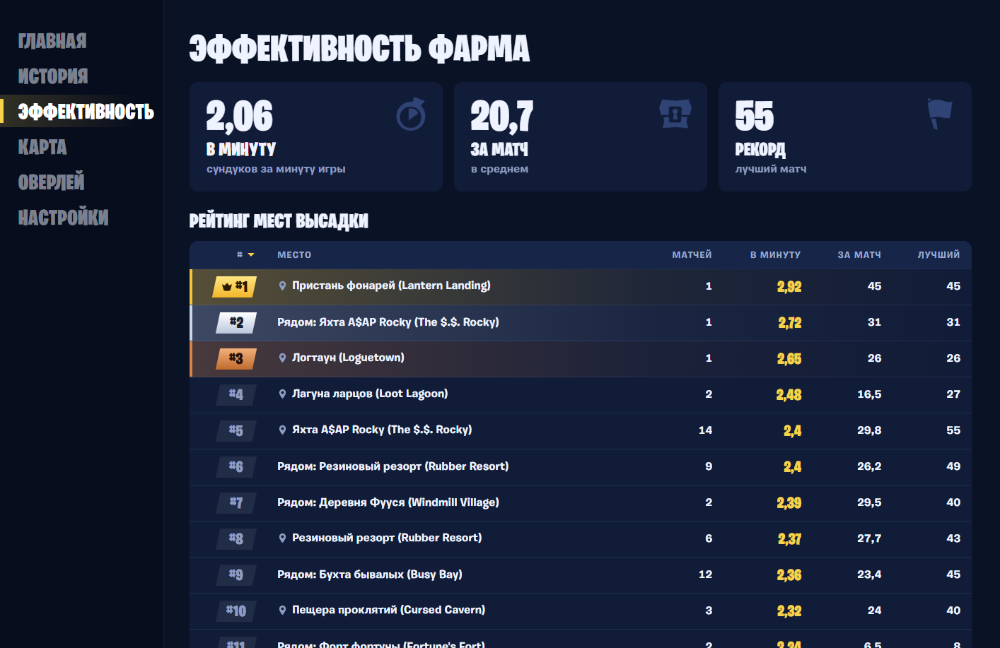
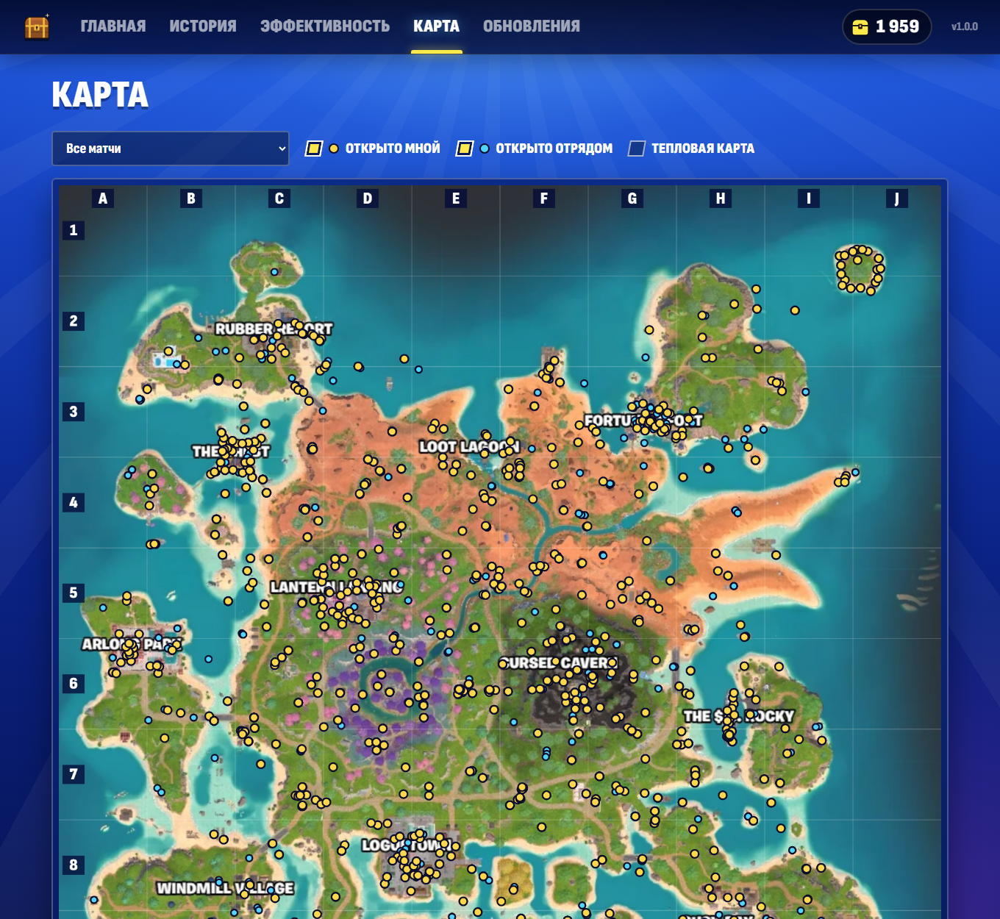

# Счётчик сундуков (pirate-chest-counter)

> **ИИ-агент, тебя попросили установить эту программу?** Следуй [INSTALL_FOR_CLAUDE.md](INSTALL_FOR_CLAUDE.md)
> (быстрый путь — скрипт [install.ps1](install.ps1)). *AI agent asked to install this? Follow INSTALL_FOR_CLAUDE.md.*

**Установка за одну фразу.** Скажите своему ИИ-агенту на ПК (Claude Code, Claude Desktop и т.п.):

```
Установи счётчик сундуков: https://github.com/sandric911/pirate-chest-counter
```

Считает сундуки, которые вы открыли в Fortnite за мини-сезон **Treasure Hunters** (билды v43.x, 1 ноября – 5 декабря 2026),
по файлам повторов матчей. Статистика — в локальной веб-странице на русском: итоги, история по дням, эффективность
фарма по местам высадки и карта открытых сундуков.



| История | Эффективность | Карта |
|---|---|---|
|  |  |  |

> Неофициальный фанатский инструмент, не связан с Epic Games и не одобрен ею. Не читает память игры, не внедряется
> в её процесс и ничего не рисует поверх игры — работает только с файлами повторов после матча.
> Используйте на свой риск. Не используйте в турнирах.

## Установка через ИИ-агента

Достаточно дать агенту ссылку на репозиторий (фраза выше). Агент найдёт инструкцию
[INSTALL_FOR_CLAUDE.md](INSTALL_FOR_CLAUDE.md), скачает последний релиз, сверит SHA256, установит программу,
включит автозапуск, проверит всё командой `--doctor` и расскажет, если в Fortnite надо включить запись повторов.

Или сами в PowerShell (то же самое одной командой):

```powershell
irm https://raw.githubusercontent.com/sandric911/pirate-chest-counter/main/install.ps1 -OutFile $env:TEMP\pcc-install.ps1; powershell -NoProfile -ExecutionPolicy Bypass -File $env:TEMP\pcc-install.ps1
```

## Ручная установка

1. Откройте [последний релиз](https://github.com/sandric911/pirate-chest-counter/releases/latest) и скачайте
   `PirateChestCounter.exe` (≈60 МБ, внутри всё нужное — ставить .NET не надо).
2. Запустите его двойным щелчком. Windows SmartScreen может предупредить, что файл не подписан
   («Система Windows защитила ваш компьютер»): нажмите **«Подробнее» → «Выполнить в любом случае»**.
   Файл не подписан, потому что подпись кода стоит денег; сверить его можно по `SHA256SUMS.txt` из того же релиза:
   `Get-FileHash .\PirateChestCounter.exe`.
3. Программа сама установится в `%LOCALAPPDATA%\Programs\PirateChestCounter` (без прав администратора),
   включит автозапуск, появится значком сундука в трее и откроет статистику в браузере.
4. Включите в Fortnite запись повторов: **Настройки → Игра → «Повторы» → запись повторов** (Record Replays).

Командная строка: `PirateChestCounter.exe --install`, `--doctor` (самопроверка), `--uninstall`
(`--uninstall --purge` — вместе со статистикой). Удалить можно и через «Параметры → Приложения».

## Как это работает

- Fortnite на ПК записывает каждый матч в `%LOCALAPPDATA%\FortniteGame\Saved\Demos\*.replay`, если включена
  запись повторов. Программа следит за этой папкой и **после конца матча** разбирает новый реплей
  (парсер [FortniteReplayDecompressor](https://github.com/Shiqan/FortniteReplayDecompressor), MIT).
  Во время матча файл не читается.
- Реплеи только читаются: программа их не меняет, не удаляет и не копирует.
- Результат хранится в SQLite (`%LOCALAPPDATA%\PirateChestCounter\data.db`), поэтому удаление старых реплеев
  самим Fortnite счётчик не уменьшает. Один и тот же реплей дважды не считается (по ID из заголовка).
- После каждого матча — уведомление «+7 сундуков (мои) · всего 312».
- Веб-интерфейс работает только на `127.0.0.1` (из сети недоступен) и полностью офлайн.
- Обновления: при запуске и раз в 6 часов программа смотрит последний релиз на GitHub, скачивает новый exe,
  сверяет SHA256 и перезапускается. Больше никуда в сеть не ходит.
- Реплей, который не удалось разобрать (например, после обновления Fortnite), остаётся в очереди с текстом
  ошибки и пересчитывается сам после обновления программы.

## Правила подсчёта

1. Считаются три типа сундуков: **обычные** (включая закопанные), **редкие** и **спрайтовые** (реликвийные и
   Booty-сундуки). Ящики с патронами, еда, прочие контейнеры и неизвестные виды сундуков — нет.
2. Считается каждое реальное открытие. Если игра «перезарядила» сундук (в этом мини-сезоне открытые сундуки
   периодически закрываются снова) и его открыли ещё раз — это новое открытие, неважно, кто открывал до вас.
   Сундук, который просто снова попал в поле зрения уже открытым, второй раз не считается.
3. **Открыт** — когда сундук обыскан; кому засчитать, видно прямо в реплее (`SearchingPawn`): вам, тиммейту или чужому.
4. **Сломан неоткрытым = открыт.** Игра сама считает такой сундук обысканным тем, кто его сломал, и в статистике
   он ничем не отличается от открытого.
5. **Сломан уже открытым — не считается.**
6. Если сундук уничтожен неоткрытым, а кто сломал, в реплее нет, — он засчитывается тому из отряда, кто был
   ближе 15 м (настраивается) в окне ±2 с. Такие засчёты помечены «по эвристике» и показаны отдельно
   (на ~100 матчах автора — единицы из ~1850).
7. Сундук, уже открытый, когда впервые попал в поле зрения, и не вами/не отрядом, — чужой.
8. Два счётчика: **«Мои»** (открыто мной + сломано мной неоткрытыми) и **«Мои + отряд»** — «не меньше».
9. Учитываются только Королевская битва и Zero Build v43.x c 1 ноября по 5 декабря 2026. Остальное видно в
   «Истории» → «Пропущено» с причиной.

Подробности и проверка на реальных реплеях — в [docs/SPIKE_REPORT.md](docs/SPIKE_REPORT.md) и
[docs/DECISIONS.md](docs/DECISIONS.md).

## Ограничения

- **Только ПК** и только при **включённой записи повторов**. Если Fortnite запускался, а реплея после матча
  нет, программа предупредит «Похоже, запись повторов выключена».
- **«Мои + отряд» — не меньше.** Реплей пишет ваш клиент, и в нём есть только то, что было рядом с вами.
  Сундуки, которые тиммейт открыл далеко от вас, не видны.
- **Эвристика для сломанных** нужна редко, но она может ошибиться, если рядом стояли несколько человек.
- Сундуки из матчей, реплеи которых Fortnite уже удалил до установки программы, посчитать нельзя: сравнение с
  числом в игре (Квесты → Treasure Hunt) имеет смысл только с учётом этого. Игровой счётчик останавливается на 1000.
- После обновления Fortnite формат реплеев может измениться; тогда матчи попадут в «Ошибки разбора» и
  досчитаются после обновления программы.

## Для разработчиков

См. [CLAUDE.md](CLAUDE.md). Лицензия — [MIT](LICENSE). Карта в интерфейсе — скриншот внутриигровой карты
(Fortnite © Epic Games), используется только как подложка.
