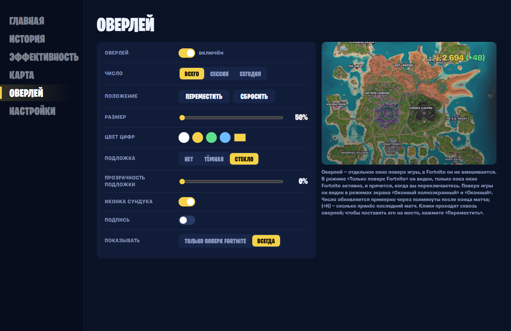

# Счётчик сундуков (Pirate Chest Counter)

Программа для Windows 11. Считает сундуки, которые вы открыли в Fortnite за мини-сезон **Treasure Hunters**
(билды v43.x, 1 ноября – 5 декабря 2026), по файлам повторов матчей. Работает в своём окне из трея, на русском или
английском, и может показывать счётчик поверх игры.

| История | Эффективность |
|---|---|
|  |  |
| **Карта** | **Оверлей** |
|  |  |

## Что умеет

- **Главная** — «Мои сундуки» и «Мои + отряд», текущая сессия с таймером, сегодня, последний матч, разбивка по
  типам (обычные, редкие, спрайтовые), лучший матч, в среднем за матч, винрейт и средняя длина игры. После матча
  числа прокручиваются, как барабан, а рядом зелёным видно, сколько сундуков принёс последний матч.
- **История** — сундуки по дням, нарастающий итог и таблица всех матчей с местом в матче.
- **Эффективность** — сундуки в минуту и за матч, рейтинг мест высадки (топ-3 подсвечены), разбор по матчам.
  На русском места называются как в игре, с английским названием в скобках: «Лагуна ларцов (Loot Lagoon)».
- **Карта** — каждый сундук, который вы открывали, и сколько раз; фильтр по матчу и типу, тепловая карта.
- **Оверлей** — ваш счётчик поверх Fortnite, например «2 592 (+45)». Положение, размер, цвет, подложка и подпись
  настраиваются. По умолчанию виден, только пока окно Fortnite активно.
- **Настройки** — язык (English / Русский), версия, копии реплеев, как включить запись повторов.

> Неофициальный фанатский инструмент, не связан с Epic Games и не одобрен ею. Не читает память игры, не внедряется
> в её процесс и не меняет её файлы: считает по файлам повторов после матча. Оверлей — отдельное окно поверх игры,
> его можно выключить. Используйте на свой риск; в турнирах оверлей лучше выключать.
>
> *Portions of the materials used are trademarks and/or copyrighted works of Epic Games, Inc. All rights reserved by
> Epic. This material is not official and is not endorsed by Epic.*

## Установка

1. Откройте [последний релиз](https://github.com/sandric911/pirate-chest-counter/releases/latest) и скачайте
   `PirateChestCounter.exe` (≈65 МБ, внутри всё нужное — ставить .NET не надо).
2. Запустите его двойным щелчком. Windows SmartScreen может предупредить, что файл не подписан
   («Система Windows защитила ваш компьютер»): нажмите **«Подробнее» → «Выполнить в любом случае»**.
   Сверить файл можно по `SHA256SUMS.txt` из того же релиза: `Get-FileHash .\PirateChestCounter.exe`.
3. Программа установится в `%LOCALAPPDATA%\Programs\PirateChestCounter` (без прав администратора), включит
   автозапуск, появится значком сундука в трее и откроет своё окно. Окно открывается щелчком по значку в трее;
   крестик прячет его обратно, а подсчёт продолжается.
4. Включите в Fortnite запись повторов: **Настройки → Игра → «Повторы» → запись повторов**.
5. Чтобы оверлей был виден поверх игры, выберите в Fortnite режим экрана **«Оконный полноэкранный»** или **«Оконный»**.

**Новая версия** ставится так же: скачайте exe из последнего релиза и запустите — он встанет поверх, статистика и
копии реплеев сохранятся.

**Удаление:** «Параметры → Приложения → Pirate Chest Counter» или `PirateChestCounter.exe --uninstall`
(`--uninstall --purge` — вместе со статистикой; копии реплеев не удаляются никогда). Самопроверка: `--doctor`.

## Как это работает

- Fortnite на ПК записывает каждый матч в `%LOCALAPPDATA%\FortniteGame\Saved\Demos\*.replay`, если включена
  запись повторов. Программа следит за этой папкой и **после конца матча** разбирает новый реплей
  (парсер [FortniteReplayDecompressor](https://github.com/Shiqan/FortniteReplayDecompressor), MIT).
  Число обновляется через несколько секунд после того, как вы вышли из матча в лобби.
- Считать прямо во время матча нельзя: пока идёт запись, данные в файле зашифрованы, а ключ Fortnite дописывает
  в него только в конце. Во время матча программа читает лишь заголовок файла (первые 4 КБ), чтобы сразу заметить
  конец записи. Если после смерти вы остаётесь смотреть за тиммейтами, запись продолжается, и число обновится,
  когда вы выйдете в лобби.
- Реплеи Fortnite программа никогда не меняет и не удаляет. После подсчёта она сохраняет копию каждого
  засчитанного матча в `%LOCALAPPDATA%\PirateChestCounter\replays` (≈12 МБ на матч): Fortnite хранит только
  около 100 последних повторов и удаляет старые, а с копиями ничего не теряется даже при пересчёте.
- Результат хранится в SQLite (`%LOCALAPPDATA%\PirateChestCounter\data.db`). Уже посчитанные реплеи при
  запуске заново не читаются. Один и тот же реплей дважды не считается.
- Окно показывает локальную страницу, доступную только самой программе. В сеть программа ходит только на GitHub,
  чтобы проверить, нет ли новой версии.
- Оверлей узнаёт, что Fortnite — активное окно, по списку процессов Windows; в игру он не заглядывает.

## Правила подсчёта

1. Считаются три типа сундуков: **обычные** (включая закопанные), **редкие** и **спрайтовые** (реликвийные и
   Booty-сундуки). Ящики с патронами, еда, прочие контейнеры и неизвестные виды сундуков — нет.
2. Считается каждое реальное открытие. Если игра «перезарядила» сундук (в этом мини-сезоне открытые сундуки
   периодически закрываются снова) и его открыли ещё раз — это новое открытие, неважно, кто открывал до вас.
   Сундук, который просто снова попал в поле зрения уже открытым, второй раз не считается. Если он вернулся в поле
   зрения открытым, а кто его открыл, в реплее нет (например, пока вы после смерти смотрели за тиммейтом), —
   он не засчитывается никому.
3. **Открыт** — когда сундук обыскан; кому засчитать, видно прямо в реплее: вам, тиммейту или чужому.
4. **Сломан неоткрытым = открыт.** Игра сама считает такой сундук обысканным тем, кто его сломал.
5. **Сломан уже открытым — не считается.**
6. Если сундук уничтожен неоткрытым, а кто сломал, в реплее нет, — он засчитывается тому из отряда, кто был
   ближе 15 м в окне ±2 с. Такое бывает редко.
7. Два счётчика: **«Мои»** и **«Мои + отряд»** («не меньше»: в реплее есть только то, что было рядом с вами).
8. Учитываются только Королевская битва и Zero Build v43.x с 1 ноября по 5 декабря 2026. Матчи короче 90 секунд
   (вышли со стартового острова, вылет игры) программа не запоминает вовсе: их нет ни в счётчиках, ни в истории.
9. **Сессия** — матчи с перерывами не больше 60 минут; таймер идёт от начала первого матча сессии.

## Ограничения

- **Только ПК** и только при **включённой записи повторов**. Если Fortnite запускался, а реплея после матча
  нет, программа предупредит «Похоже, запись повторов выключена».
- **«Мои + отряд» — не меньше.** Сундуки, которые тиммейт открыл далеко от вас, в вашем реплее не видны.
- Сундуки из матчей, реплеи которых Fortnite уже удалил до установки программы, посчитать нельзя.
  Игровой счётчик в квестах останавливается на 1000.
- После обновления Fortnite формат реплеев может измениться; тогда такие матчи подождут и досчитаются сами
  после обновления программы.
